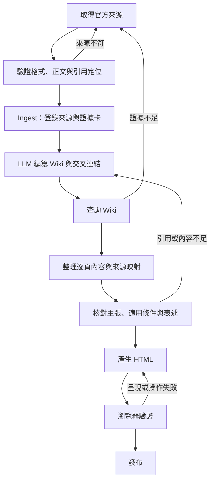

# 知識編纂與驗證流程

輸入為官方來源的精選證據卡，輸出為互連 Wiki、可追溯簡報與靜態網站。資料、文字、呈現各自有明確邊界。

## 節點責任

1. 來源登錄保留 ID、官方 URL、版本日期、原取得時間與段落定位；內容雜湊用來核對精選證據卡。
2. Ingest 將六份證據卡登錄進資料庫，檢查唯一 ID 與引用關係。
3. LLM 編纂保留來源差異，將內容整理成互連概念。只有此階段產生或修訂知識；本地重建指令僅保存已有產出。
4. 查詢回傳 Wiki 條目與相關來源，缺乏證據時先補來源再改稿。
5. 每張簡報保留 Wiki ID 與來源 ID；渲染程式只處理呈現。
6. 驗證包含本地連結、來源覆蓋、翻頁、情境按鈕、窄螢幕與頁面溢出。

## 回退與停止

失敗只回到負責該問題的節點，修正後重跑受影響的檢查。來源、內容與介面檢查通過後發布。對來源仍有疑問時保留限制，不以模型補寫取代證據。

本機 `rebuild` 執行的是已保存內容的重播；它不會重新抓取官方網站或呼叫 LLM。新來源與實質內容變更需另外經過來源核對及編纂。
